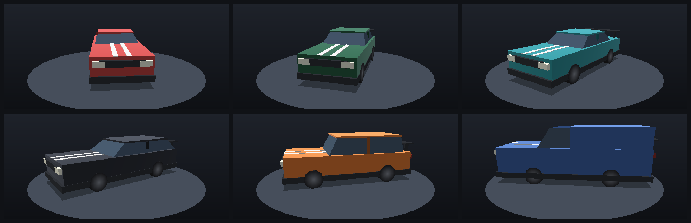
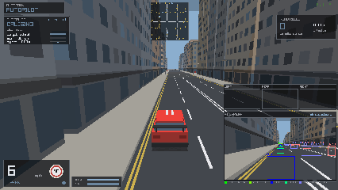

# autobahn

> *autobahn* — a quarter mile at a time. The autopilot manages fifteen miles an hour, and never gets a ticket.

[](https://github.com/danielriddell21/autobahn/actions/workflows/ci.yaml)
[](https://codecov.io/gh/danielriddell21/autobahn)
[](https://sonarcloud.io/summary/new_code?id=danielriddell21_autobahn3)
[](https://go.dev)
[](LICENSE)

A 3D driving game in Go. Part one is you, a car, and a procedurally generated
British city with traffic, lights, signs, road rules and police. Part two hands
the same car to an autopilot that sees the world **only through a camera**, as
colour-coded detection boxes it has to read back out of the pixels.

Both drivers are scored by the same judge, so the comparison is honest.

Drive badly enough where a unit can see it and the police come after you. A
pursuit escalates for as long as you stay in sight: patrol cars first, sat
behind with their lights on, then interceptors that go for your back corner,
then heavy units and roadblocks. Every second of it earns a bounty, which you
keep only by getting away — break the line of sight round a corner and stay
gone until they give up. Get stopped and it is forfeit. Traffic pulls over for
the sirens, goes round the wrecks, and brakes for the car coming through a red.

Nobody else on the road drives alike. Some sit under the limit and let you out
of a side road; some change lane to get past, pass on the wrong side of a
single carriageway when it is clear, flash their lights at whoever is holding
them up and lean on the horn at a green. The autopilot does the same from what
its cameras show it — a bonnet camera to steer by and three mirrors to check
before it moves over — in whichever style you set it to.

Pick your car in the garage, from the title screen or the pause menu: a hot
hatch, a hatchback, a saloon, an estate, a taxi or a van, each of which drives
the way it looks, in any of a dozen paints.



| Key | |
| --- | --- |
| `W` `A` `S` `D` | drive |
| `Space` | handbrake |
| `Shift` | nitrous, which a slide earns back |
| `Tab` | hand the car to the autopilot, or take it back |
| `C` | camera |
| `T` | time of day: day, dusk, night |
| `H` | the rest |

Two people can play: one hosts a chase and drives the runner, the other joins
over the network and gives chase in a police car. Set it up from the title
screen, or with `-host` and `-join`.



*The autopilot at the wheel. The panel in the corner is the image it is reading.*

## Install

### Homebrew (macOS)
```sh
brew install --cask danielriddell21/tap/autobahn
```

### From source
```sh
just run              # drive it yourself
just drive            # hand the car to the autopilot
just ci               # lint + test + build + the boundary check + the autopilot gate
```

Or without `just`:

```sh
go run -tags x11 ./cmd/autobahn            # the x11 tag is Linux-only
go run -tags x11 ./cmd/autobahn -autopilot
```

raylib needs a windowing backend. On Linux, `-tags x11` builds against X11
alone, which avoids needing the Wayland development headers; on macOS and
Windows no tag is required. The `justfile` picks the right one for you.

Everything is generated in code — geometry, layout, materials. There are no
asset files, nothing is downloaded at runtime, and the whole thing runs offline.

The city has no edge. It is built outward as you drive into it, a junction at a
time, and everything about a place is decided from where that place is rather
than from when you got there — so the town behind you is still the town you
left, and there is always more road ahead.

The engine underneath is [crucible](https://github.com/danielriddell21/crucible),
shared with the rest of the family: the city's street plan comes from its
world generator, the menus from its menu model, the two-player session from
its netplay package, and the recording flags are the same `-record` every
other app answers to.

## Documentation

Full documentation lives in the [autobahn wiki](https://github.com/danielriddell21/autobahn/wiki) —
the city and its rules, the camera-only autopilot, pursuit mode, the synthesised
sound, and how the media above is generated.
