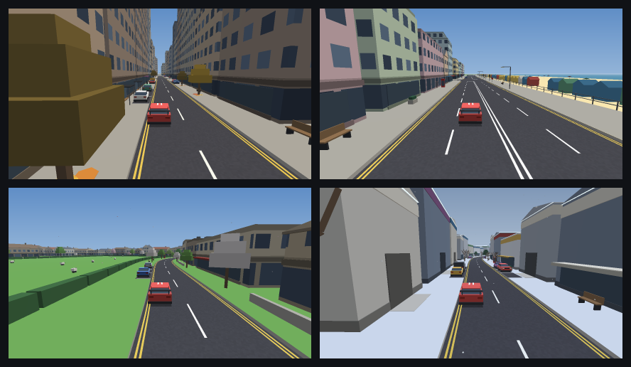

# autobahn

> *autobahn* — a quarter mile at a time. The autopilot manages fifteen miles an hour, and never gets a ticket.

[](https://github.com/danielriddell21/autobahn/actions/workflows/ci.yaml)
[](https://codecov.io/gh/danielriddell21/autobahn)
[](https://sonarcloud.io/summary/new_code?id=danielriddell21_autobahn3)
[](https://go.dev)
[](LICENSE)

A 3D driving game in Go. Part one is you, a car, and a procedurally generated
British city with traffic, lights, signs, road rules and police. Part two hands
the same car to an autopilot that sees the world **only through a camera**, as
colour-coded detection boxes it has to read back out of the pixels.

| Key | |
| --- | --- |
| `W` `A` `S` `D` | drive |
| `Space` | handbrake |
| `Shift` | nitrous, which a slide earns back |
| `Tab` | hand the car to the autopilot, or take it back |
| `C` | camera |
| `T` | skip ahead to the next time of day |
| `H` | the rest |


*The autopilot at the wheel. The panel in the corner is the image it is reading.*

## Maps and packs

There are four places to drive, each in its own season. All of them are the
same generator asked for something different, so none of them runs out: the
seaside stops at the sea, and nothing stops anywhere else. The city is a
grid. The other three are planned on one and then laid on ground that
wanders, so their streets bend: the village winds, the seaside curves, and
the motorway's dual carriageways sweep. Their open ground rises too: fields
climb behind their hedges, there is a hill behind the houses, and downs,
headlands or moors stand on the horizon.

| Map | Season | | Pack |
| --- | --- | --- | --- |
| `city` | autumn | where it began: towers, shop fronts, leaves coming down | base |
| `seaside` | summer | painted terraces, a promenade, a beach and the sea down one side | coast |
| `village` | spring | stone cottages on long lanes, with hedged fields between them | country |
| `motorway` | winter | dual carriageways at fifty, under snow, with less grip in a bend | motorway |



The city is the base game. The other three come in packs, each with cars of
its own for the garage, and a pack unlocks once the bounty you have banked
across every drive reaches its price.

## Install

### Homebrew (macOS)
```sh
brew install --cask danielriddell21/tap/autobahn
```

### From source
```sh
just run              # drive it yourself
just drive            # hand the car to the autopilot
just eval -map all    # score the autopilot on every map
just ci               # lint + test + build + the boundary check + the autopilot gate
```

Without `just`, Linux needs `-tags x11`: `go run -tags x11 ./cmd/autobahn`.

Everything is generated in code, with no asset files, and a map is not a
fixed size: it is built outward as you drive. The engine underneath is
[crucible](https://github.com/danielriddell21/crucible).

## Documentation

Full documentation lives in the [autobahn wiki](https://github.com/danielriddell21/autobahn/wiki) —
the city and its rules, the camera-only autopilot, pursuit mode, the synthesised
sound, and how the media above is generated.
